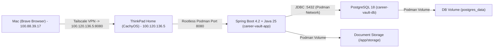

# Implementation Plan: Career Vault (Job Application Tracker & Personal Document Vault)

## Goal Description

Build **Career Vault**, a private, login-protected local web application under [`/home/imron/Documents/locale-project/career-vault`](file:///home/imron/Documents/locale-project/career-vault) using **Java 25**, **Spring Boot 4.2.0** (Spring MVC + Thymeleaf + Spring Data JPA + Spring Security 7 + Flyway), **PostgreSQL 18**, and **Tabler 1.7.5 (Bootstrap 5.3)**, running via **rootless Podman + `podman-compose`** without installing Docker, so the CachyOS host stays clean.

The application provides two tightly integrated private modules behind Spring Security login:
1. **Job Application Tracker**: Track job applications (company, role, platform, work mode, salary range, status pipeline, follow-up dates, notes, status change timeline, CSV export) and link each application to the exact CV and Cover Letter version used.
2. **Career Document Vault (File Manager)**: Upload, categorize, version, search, preview in-browser (PDF/images), and download personal career files (`CV`, `Cover Letter`, `Project`, `Certificate`, `Ijazah`, `Transkrip Nilai`, `Photo`, `ID Document`, `Other`) anytime from your Mac over Tailscale.

---

## User Review Required

> [!IMPORTANT]
> **Host Prerequisite (Rootless Podman Only — No Docker)**
> Checked on `thinkpad-home` (`hostname: cachyos-x8664`): `podman` and `podman-compose` are not installed on this machine yet (`which podman` returned not found, and `pacman -Qe` has no container engine installed). `/etc/subuid` and `/etc/subgid` already have `imron:100000:65536` configured for rootless containers.
> During execution (after your approval), we will install **only Podman** (`sudo pacman -S --needed podman podman-compose netavark aardvark-dns`) — no Docker daemon needed — and enable user lingering (`sudo loginctl enable-linger imron`) so your containers stay running after SSH disconnects.

> [!IMPORTANT]
> **Private Access via Tailscale (IP Address for Brave on Mac)**
> Checked on `thinkpad-home`:
> - **Tailscale IP (`tailscale0`)**: `100.120.136.5`
> - **Home Wi-Fi IP (`wlan0`)**: `192.168.18.11`
> - **Mac client in Tailscale**: `100.88.39.17` (`macbooks-macbook-air`)
>
> In Brave on your Mac, open: **`http://100.120.136.5:8080`** (or `http://thinkpad-home:8080` if MagicDNS is enabled).
> - With **Exit Node -> `thinkpad-home`** and **Allow Local Network Access** enabled on Mac, `http://100.120.136.5:8080` works everywhere (at home or outside).
> - `http://192.168.18.11:8080` also works when your Mac is on the same home Wi-Fi (`192.168.18.x`).
> - Note: You do **not** need Exit Node turned on just to reach `100.120.136.5:8080`; Tailscale connection alone is enough.
> - Port `8080` works cleanly in **rootless Podman** (no root privileges needed for ports >= 1024). By default, `compose.yaml` uses `${APP_BIND_IP:-0.0.0.0}:${APP_PORT:-8080}:8080`. Every route (except `/login`, `/vendor/**`, `/css/**`, `/js/**`, `/actuator/health`) requires login.

> [!NOTE]
> **Default Login & Local Storage Decisions**
> - Initial admin username/password will be configured via `.env` (`APP_ADMIN_USERNAME`, `APP_ADMIN_PASSWORD`) and seeded once with BCrypt hashing if `user_accounts` is empty.
> - PostgreSQL data and uploaded files will live in persistent Podman named volumes (`postgres_data` and `career_uploads`) so container rebuilds never delete your files or records, and rootless volume permissions work cleanly.
> - Tabler `1.7.5` CSS/JS and Tabler Icons assets will be bundled locally under `src/main/resources/static/vendor/tabler/` (MIT license) so the dashboard loads fast without depending on external CDNs.

---

## Architecture & Network Topology



---

## Proposed Changes

All new files will be created inside [`/home/imron/Documents/locale-project/career-vault/`](file:///home/imron/Documents/locale-project).

### 1. Rootless Podman & Environment Infrastructure

#### [NEW] compose.yaml
Defines two isolated services on a Podman bridge network (`netavark`):
- `db` (`docker.io/library/postgres:18-alpine`): stores relational data in `postgres_data` volume with `pg_isready` healthcheck; port `5432` stays internal to the container network (not exposed publicly). Uses fully-qualified `docker.io/library/` image name for non-interactive Podman pulls.
- `app` (built from `Containerfile`): runs Spring Boot on Java 25, depends on `db` (`service_healthy`), mounts `career_uploads:/app/storage`, exposes `${APP_BIND_IP:-0.0.0.0}:${APP_PORT:-8080}:8080`, and includes an `/actuator/health` healthcheck.

#### [NEW] Containerfile & entrypoint.sh
Multi-stage build compatible with Podman (`buildah`) and Docker:
- **Build stage**: `docker.io/library/maven:3-eclipse-temurin-25` caches dependencies (`mvn dependency:go-offline`) and builds the executable JAR.
- **Runtime stage**: `docker.io/library/eclipse-temurin:25-jre-alpine` runs as non-root user (`spring:spring`), pre-creates `/app/storage` owned by `spring:spring` (so Podman copies correct ownership into empty named volume `career_uploads`), and uses `entrypoint.sh` to wait cleanly for `db:5432` before starting `java -XX:MaxRAMPercentage=75.0 -jar /app/app.jar` (guarding against `podman-compose` starting `app` before Postgres finishes init).

#### [NEW] .env.example & .env & .gitignore
- `.env.example` documents required variables (`POSTGRES_DB`, `POSTGRES_USER`, `POSTGRES_PASSWORD`, `APP_ADMIN_USERNAME`, `APP_ADMIN_PASSWORD`, `APP_BIND_IP`, `APP_PORT`).
- `.gitignore` excludes `.env`, `target/`, IDE files, and local test storage folders.

---

### 2. Maven & Spring Boot 4.2 Configuration

#### [NEW] pom.xml
Uses `spring-boot-starter-parent` `4.2.0` and `<java.version>25</java.version>` with Spring Boot 4 modular starters:
- Production starters:
  - `spring-boot-starter-webmvc` (renamed from `starter-web` in Boot 4)
  - `spring-boot-starter-thymeleaf`
  - `spring-boot-starter-security`
  - `spring-boot-starter-validation`
  - `spring-boot-starter-data-jpa`
  - `spring-boot-starter-flyway` + `org.flywaydb:flyway-database-postgresql`
  - `spring-boot-starter-actuator`
  - `org.postgresql:postgresql` (`runtime`)
- Modular test starters (Spring Boot 4 requirement):
  - `spring-boot-starter-test`
  - `spring-boot-starter-webmvc-test`
  - `spring-boot-starter-data-jpa-test`
  - `spring-boot-starter-security-test`
  - `com.h2database:h2` (`test`)

#### [NEW] src/main/resources/application.yaml & application-test.yaml
- `application.yaml`: PostgreSQL datasource from environment variables, `spring.jpa.hibernate.ddl-auto=validate`, `spring.flyway.enabled=true`, multipart limits (`max-file-size: 50MB`, `max-request-size: 55MB`), `app.storage.root=${APP_STORAGE_ROOT:/app/storage}`, `server.forward-headers-strategy=framework`.
- `application-test.yaml`: H2 in `MODE=PostgreSQL` with Flyway disabled (`spring.jpa.hibernate.ddl-auto=create-drop`) and a temporary upload folder for isolated test execution.

---

### 3. Database Schema & Migrations

#### [NEW] src/main/resources/db/migration/V1__init_schema.sql
Creates normalized tables with explicit constraints and indexes:
- `user_accounts`: `id`, `username` (unique), `password_hash`, `full_name`, `role`, `created_at`.
- `career_documents`: `id`, `title`, `category`, `version_label`, `issuer_or_context`, `document_date`, `tags`, `description`, `original_filename`, `stored_filename` (unique), `content_type`, `file_size_bytes`, `sha256_checksum`, `is_primary`, `created_at`, `updated_at`.
- `job_applications`: `id`, `company_name`, `role_title`, `job_url`, `platform`, `work_mode`, `location`, `salary_range`, `status`, `applied_date`, `follow_up_date`, `contact_person`, `notes`, `cv_document_id` (FK -> `career_documents.id` `ON DELETE SET NULL`), `cover_letter_document_id` (FK -> `career_documents.id` `ON DELETE SET NULL`), `created_at`, `updated_at`.
- `job_status_history`: `id`, `job_application_id` (FK -> `job_applications.id` `ON DELETE CASCADE`), `from_status`, `to_status`, `note`, `changed_at`.
- Indexes on `job_applications(status)`, `job_applications(applied_date DESC)`, `career_documents(category)`, and `job_status_history(job_application_id)`.

---

### 4. Domain Layer & Repositories (`id.imron.careervault.domain`, `.repository`)

#### [NEW] Entities & Enums
- `JobStatus` enum: `SAVED`, `APPLIED`, `HR_SCREEN`, `TECHNICAL_TEST`, `INTERVIEW`, `OFFER`, `REJECTED`, `WITHDRAWN` (with display label and Tabler badge color class).
- `WorkMode` enum: `REMOTE`, `HYBRID`, `ONSITE`.
- `DocumentCategory` enum: `CV`, `COVER_LETTER`, `PROJECT`, `CERTIFICATE`, `IJAZAH`, `TRANSCRIPT`, `PHOTO`, `ID_DOCUMENT`, `OTHER` (with icon class and badge color).
- `UserAccount`, `CareerDocument`, `JobApplication`, `JobStatusHistory` JPA entities using `@PrePersist` / `@PreUpdate` timestamps and clean entity relationships.

#### [NEW] Repositories
- `UserAccountRepository` (`findByUsername`)
- `JobApplicationRepository` (`JpaRepository` + `JpaSpecificationExecutor` for combined keyword/status/workMode/platform filtering and pagination; aggregate count by status queries for dashboard KPIs)
- `JobStatusHistoryRepository` (`findByJobApplicationIdOrderByChangedAtDesc`)
- `CareerDocumentRepository` (`JpaRepository` + `JpaSpecificationExecutor` for keyword/category filtering; category counts and total file bytes query)

---

### 5. DTOs & Form Validation (`id.imron.careervault.dto`)

Strictly decouple HTTP form binding from JPA entities:
- `JobApplicationForm`: Bean validation (`@NotBlank` on `companyName` & `roleTitle`, `@NotNull` on `status` & `workMode`, `@Size` limits, optional URL validation, optional `cvDocumentId` & `coverLetterDocumentId`).
- `JobStatusUpdateForm`: `newStatus`, `note`.
- `JobSearchFilter`: `keyword`, `status`, `workMode`, `platform`.
- `DocumentUploadForm`: `file` (`MultipartFile`), `title`, `category`, `versionLabel`, `issuerOrContext`, `documentDate`, `tags`, `description`, `isPrimary`.
- `DocumentEditForm`: metadata fields + optional replacement `MultipartFile`.
- `DashboardSummaryDto`: total jobs, active pipeline count, offer count, status breakdown map, upcoming follow-ups, recent applications, total files, total storage size formatted, document count per category.

---

### 6. Service & Storage Layer (`id.imron.careervault.service`)

#### [NEW] LocalFileStorageService.java
- Validates non-empty file, size limit, and allowed file extensions/content types (`pdf`, `png`, `jpg`, `jpeg`, `webp`, `doc`, `docx`, `xls`, `xlsx`, `ppt`, `pptx`, `txt`, `md`, `zip`).
- Generates safe `UUID` + sanitized extension `storedFilename` (never trusting raw client paths).
- Guards every read/write/delete path with `.toAbsolutePath().normalize().startsWith(rootPath)`.
- Computes SHA-256 checksum on upload and returns Spring `Resource` for streaming download and inline preview.

#### [NEW] CareerDocumentService.java
- Search & filter documents by keyword (title, tags, issuer, filename) and `DocumentCategory` with `Pageable`.
- Store new document (transactional DB save + file write with cleanup on failure; if `isPrimary=true` for a category like `CV`, unsets previous primary in that category).
- Update document metadata and optionally replace stored file (deletes old physical file only after DB update succeeds).
- Delete document cleanly (DB record + physical file).
- Export safe download metadata (`originalFilename`, `contentType`, `Resource`).

#### [NEW] JobApplicationService.java
- Search/filter/paginate job applications via Spring Data `Specification`.
- Create/update job application and link optional CV/Cover Letter documents.
- Record initial `JobStatusHistory` entry on create and new history entry whenever `status` changes (including quick-status updates from detail page).
- Export all/filtered applications to UTF-8 CSV for offline backup.

#### [NEW] DashboardService.java
- Builds `DashboardSummaryDto` (pipeline stats, status breakdown percentages, upcoming `followUpDate` alerts, recent 5 applications, recent 6 documents, storage usage).

---

### 7. Security & WebMVC Controllers (`id.imron.careervault.config`, `.controller`)

#### [NEW] SecurityConfig.java & AdminSeedConfig.java
- Spring Security 7 Lambda DSL (`SecurityFilterChain`):
  - `permitAll()` ONLY for `/login`, `/vendor/**`, `/css/**`, `/js/**`, `/actuator/health`.
  - `.anyRequest().authenticated()` for everything else (all dashboard, job tracker, document upload/preview/download/delete routes).
  - Form login at `/login` redirecting to `/dashboard`, POST `/logout` clearing session, `BCryptPasswordEncoder`.
- `DatabaseUserDetailsService`: loads `UserAccount` from PostgreSQL.
- `AdminSeedConfig`: seeds initial user from `APP_ADMIN_USERNAME` / `APP_ADMIN_PASSWORD` only if `user_accounts` has 0 rows.

#### [NEW] Controllers & Global Advice
- `GlobalViewAdvice` (`@ControllerAdvice`): injects `currentUserFullName` and friendly `GlobalExceptionHandler` handling `MaxUploadSizeExceededException` (`413`), `EntityNotFoundException` (`404`), and unexpected errors cleanly in the Tabler UI.
- `AuthController`: `GET /login`.
- `DashboardController`: `GET /` (redirect `/dashboard`), `GET /dashboard`.
- `JobApplicationController`:
  - `GET /jobs` (filtered & paginated table)
  - `GET /jobs/new`, `POST /jobs` (PRG pattern + flash message)
  - `GET /jobs/{id}` (detail + status timeline + quick status change + attached CV/Cover Letter download buttons)
  - `GET /jobs/{id}/edit`, `POST /jobs/{id}`
  - `POST /jobs/{id}/status` (quick pipeline status transition + note)
  - `POST /jobs/{id}/delete`
  - `GET /jobs/export.csv`
- `CareerDocumentController`:
  - `GET /documents` (category tabs with counts + search + cards/table)
  - `GET /documents/upload`, `POST /documents/upload`
  - `GET /documents/{id}/edit`, `POST /documents/{id}/edit`
  - `GET /documents/{id}/download` (`Content-Disposition: attachment; filename*=UTF-8''...`)
  - `GET /documents/{id}/preview` (`Content-Disposition: inline` + `X-Content-Type-Options: nosniff` for PDF & images)
  - `POST /documents/{id}/delete`

---

### 8. Frontend UI (Tabler `1.7.5` + Bootstrap 5.3 + Pure Thymeleaf Fragments)

Uses native Thymeleaf fragment parameterization (`th:replace="~{layout/app :: layout(...)}"`) — avoiding `thymeleaf-layout-dialect` for clean Spring Boot 4 compatibility.

#### [NEW] Static Assets & Templates
- `src/main/resources/static/vendor/tabler/` — MIT-licensed `@tabler/core` `1.7.5` (`tabler.min.css`, `tabler.min.js`) and `@tabler/icons-webfont` CSS + fonts bundled locally.
- `src/main/resources/static/css/app.css` & `src/main/resources/static/js/app.js` — dark/light theme persistence (`data-bs-theme` via `localStorage`), delete confirmation modal helper, file size display, PDF/image preview modal.
- `templates/layout/app.html` — Tabler vertical sidebar + top navbar (Dashboard, Job Applications, Document Vault, Quick Upload, Dark Mode toggle, User logout POST button).
- `templates/auth/login.html` — Centered Tabler login card.
- `templates/dashboard/index.html` — KPI cards, pipeline breakdown bar, upcoming follow-ups, recent applications, quick links to primary CV & latest documents.
- `templates/jobs/list.html`, `form.html`, `detail.html` — Search/filter bar, status badges, CV/Cover Letter selectors, interactive status timeline.
- `templates/documents/list.html`, `form.html` — Category filter pills (`CV`, `Cover Letter`, `Project`, `Certificate`, `Ijazah`, `Transkrip Nilai`, `Photo`, `ID Document`, `Other`), inline preview modal for PDFs & images, 1-click download, primary badge toggle.
- `templates/error/error.html` — Clean Tabler error page.

---

## Verification Plan

### Automated Tests
Run inside a rootless Maven + Java 25 Podman container (zero Maven/JDK installed on host):
```bash
podman run --rm -v "$PWD":/app:Z -w /app docker.io/library/maven:3-eclipse-temurin-25 mvn test
```
Test suite will cover:
1. `LocalFileStorageServiceTest`: safe UUID naming, path traversal rejection (`../`), SHA-256 checksum accuracy, allowed/disallowed file type checks, delete behavior.
2. `JobApplicationServiceTest`: status transition history creation, filtering, CSV generation.
3. `CareerDocumentServiceTest`: primary CV switching, file replacement cleanup, delete cleanup.
4. `SecurityAndMvcIntegrationTest` (`@SpringBootTest` + `MockMvc` + `@WithMockUser`):
   - Unauthenticated `GET /dashboard`, `GET /jobs`, `GET /documents`, `GET /documents/1/download` redirect to `/login`.
   - Authenticated `POST /jobs` validation errors return form view; valid `POST` persists and redirects (PRG).
   - Authenticated `POST /documents/upload` uploads a sample PDF, `GET /documents/{id}/preview` returns inline `application/pdf`, `GET /documents/{id}/download` returns attachment header.

### Manual & Live Rootless Podman Verification
1. Verify Podman installation & rootless setup on CachyOS:
   ```bash
   podman --version && podman-compose --version && podman info --format '{{.Host.Security.Rootless}}'
   ```
2. Build and start containers with rootless Podman:
   ```bash
   cd /home/imron/Documents/locale-project/career-vault
   cp .env.example .env
   podman-compose up -d --build
   podman ps
   ```
   Verify both `career-vault-db` (`postgres:18-alpine`) and `career-vault-app` are running and healthy.
3. Verify Flyway migration and seeded admin in `postgres:18-alpine`:
   ```bash
   podman exec career-vault-db psql -U "$POSTGRES_USER" -d "$POSTGRES_DB" -c "\dt"
   ```
4. End-to-end HTTP smoke check locally (`http://127.0.0.1:8080`) and on Tailscale IP (`http://100.120.136.5:8080`):
   - Verify unauthenticated access redirects to `/login`.
   - Log in, upload sample CV PDF + Certificate image, verify inline preview + file download, create a Job Application linked to the CV, change status (`APPLIED` -> `INTERVIEW`), verify timeline & CSV export, then restart containers (`podman-compose restart`) to confirm persistence across restarts.
5. **On your Mac (Brave Browser)**:
   - Connect Tailscale (with or without Exit Node `thinkpad-home`) and open `http://100.120.136.5:8080`.
   - Confirm login, document preview, and download work smoothly from Mac.
